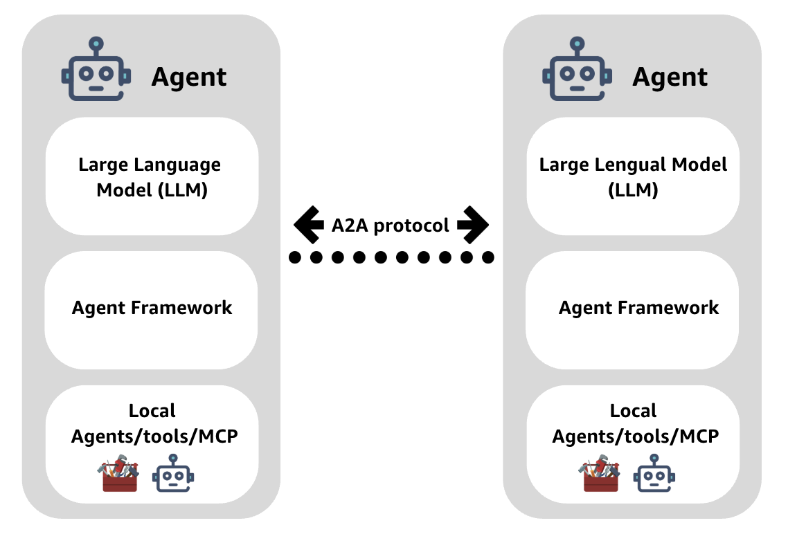

# Strands Agent-to-Agent (A2A) Communication

This project is a small demonstration of agents communicating through the
Agent-to-Agent (A2A) protocol. An HR agent accepts a question over HTTP, asks an
Employee agent for information, and the Employee agent calls tools exposed by
an MCP server.

## Architecture



The diagram below shows how the services in this example connect:

```text
Your HTTP request
       |
       v
HR Agent (127.0.0.1:8000)
       |
       | A2A
       v
Employee Agent (localhost:8001)
       |
       | MCP over streamable HTTP
       v
Employee MCP Server (127.0.0.1:8002)
```

## Project contents

- `run_a2a_system.py` starts all three services and streams their logs to the
  terminal.
- `strands-a2a-inter-agent/hr-agent.py` provides the HR HTTP API.
- `strands-a2a-inter-agent/employee-agent.py` serves the Employee agent and
  connects it to the MCP tools.
- `strands-a2a-inter-agent/server.py` exposes employee and skill lookup tools.
- `strands-a2a-inter-agent/employee_data.py` generates sample employees and
  skills when the MCP server starts.
- `a2a-communication.ipynb` contains the Lab 05 notebook walkthrough.
- `Lab5-Deck.pdf` contains the accompanying lab slides.

## Requirements

- Python and `pip`
- An OpenAI API key with access to `gpt-4o`
- The Python packages listed in `requirements.txt`

The agents configure LiteLLM to use `openai/gpt-4o` and read credentials from
the `OPENAI_API_KEY` environment variable.

## Setup and run

From the project root, create and activate a virtual environment, then install
the dependencies:

```powershell
py -m venv .venv
.\.venv\Scripts\Activate.ps1
python -m pip install -r requirements.txt
```

Set your API key for the current PowerShell session and start the services:

```powershell
$env:OPENAI_API_KEY = "your-openai-api-key"
python .\run_a2a_system.py
```

Keep this terminal open while using the system. The runner starts the MCP
server, then the Employee agent, then the HR agent. Press **Ctrl+C** in the
terminal to stop the services.

> **Ports:** The services use ports `8000`, `8001`, and `8002`. Make sure they
> are available before starting. The runner's automatic port cleanup uses
> `lsof` and `kill`, which are not available in a default Windows installation;
> on Windows, stop any process already using these ports yourself.

## Make a request

The HR agent exposes `GET /health` and `POST /inquire`. Send a question to the
`/inquire` endpoint from another PowerShell window:

```powershell
$body = @{ question = "List employees with Python or machine learning skills." } | ConvertTo-Json
Invoke-RestMethod `
  -Uri "http://127.0.0.1:8000/inquire" `
  -Method Post `
  -ContentType "application/json" `
  -Body $body
```

Check that the HR API is responding:

```powershell
Invoke-RestMethod -Uri "http://127.0.0.1:8000/health"
```

The `/inquire` response is streamed as plain text. Employee names and their
assigned skills are generated randomly at MCP server startup, so results can
differ between runs.

## Notes

- Set `OPENAI_API_KEY` before starting the services. The runner also checks a
  separate lowercase `api_key` variable and inserts a dummy value when it is
  absent; that placeholder is **not** the credential used by the agents.
- The MCP server provides `get_skills` and `get_employees_with_skill` tools.
- For details on the inter-agent example, see
  [`strands-a2a-inter-agent/README.md`](strands-a2a-inter-agent/README.md).
