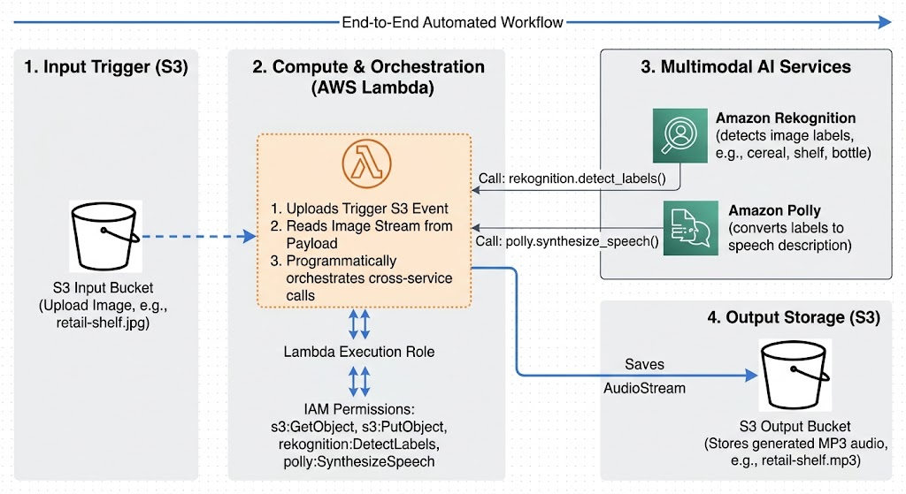

# Smart Retail Vision Narrator

This project demonstrates how to combine Amazon Rekognition and Amazon Polly to create a simple voice-based retail assistant. When an image is uploaded to an Amazon S3 bucket, an AWS Lambda function analyzes the image with Rekognition, converts the detected labels into a spoken description, and saves the generated MP3 audio to an output S3 bucket.

The solution is designed for a retail scenario where product shelves can be described aloud for accessibility or customer-facing narration.

## Project Overview

The workflow is:

1. Upload an image such as `retail-shelf.jpg` to an S3 input bucket.
2. S3 triggers an AWS Lambda function.
3. Lambda uses Amazon Rekognition to detect labels in the image.
4. A text description is generated from the detected objects.
5. Amazon Polly converts that text into speech.
6. The resulting MP3 is saved into an output bucket.

## Architecture

```text
Upload Image -> S3 Input Bucket -> Lambda Trigger -> Rekognition -> Polly -> S3 Output Bucket
```



## Files in This Project

- `Lamda_function.py` - AWS Lambda function that detects image labels and synthesizes speech.
- `SmartRetailVisionNarrator.ipynb` - Notebook version of the workflow for testing directly with boto3.
- `lambdatestEvent.txt` - Sample event payload used to test the Lambda function locally or in AWS.
- `retail-shelf.jpg` - Sample retail shelf image used for demonstration.
- `retail-shelf.mp3` - Generated spoken audio output from the project.

## What the Lambda Does

The Lambda function:

- Reads the uploaded image from the S3 event payload.
- Calls `rekognition.detect_labels()` with a confidence threshold.
- Builds a sentence describing the detected items.
- Calls `polly.synthesize_speech()` to generate MP3 audio.
- Uploads the output audio file to a configured output S3 bucket.

## Prerequisites

Before running this project, make sure you have:

- An AWS account
- AWS CLI configured with valid credentials
- Python 3.x
- Boto3 installed
- IAM permissions for:
  - Amazon Rekognition
  - Amazon Polly
  - Amazon S3
- A valid S3 bucket for uploaded images and another bucket for audio output
- A Lambda function configured with Python runtime

## AWS Setup

### 1. Create Input and Output Buckets

Create two S3 buckets in the same AWS region (the project currently uses `us-east-2`).

Example:

```bash
aws s3 mb s3://your-input-bucket --region us-east-2
aws s3 mb s3://your-output-bucket --region us-east-2
```

### 2. Update the Lambda Code

In `Lamda_function.py`, update the following values:

- Lambda region if needed
- Output bucket name
- Optional image/key handling if you use different file types

Example in the script:

```python
s3.put_object(
    Bucket='rekognition-output-audio-274285228998-us-east-2-an',
    Key=audio_key,
    Body=audio['AudioStream'].read(),
    ContentType='audio/mpeg'
)
```

Replace the bucket name with your actual output bucket name.

### 3. IAM Role Permissions

Your Lambda execution role should allow:

- `rekognition:DetectLabels`
- `polly:SynthesizeSpeech`
- `s3:GetObject`
- `s3:PutObject`

### 4. Configure the S3 Trigger

Configure the Lambda function to trigger when an object is uploaded to the input bucket.

### 5. Upload a Test Image

Upload the sample image:

```bash
aws s3 cp retail-shelf.jpg s3://your-input-bucket/
```

Once uploaded, the Lambda function should process the image and create a matching MP3 file in the output bucket.

## Running the Notebook

Open `SmartRetailVisionNarrator.ipynb` in Jupyter or SageMaker Studio and run the cells in order.

This notebook demonstrates the same flow directly using `boto3`, which is helpful for local testing before or alongside Lambda deployment.

Important requirements:

- The notebook must run in an environment with AWS credentials configured.
- The execution role should have enough permissions to use Rekognition, Polly, and S3.
- The `retail-shelf.jpg` file should be in the same folder as the notebook or be referenced correctly in the code.

## Example Output

A generated description may look like this:

```text
I can see the following items. cereal, shelf, packaged food, drink, bottle,
```

This text is sent to Polly, which produces an MP3 file with the spoken narration.

## Notes

- The current code is a simple demo and uses `MaxLabels=5` and `MinConfidence=80` for Rekognition.
- The script currently assumes JPEG input files (for example, `.jpg`).
- Region and bucket names must match your AWS configuration.
- The project is useful as a starting point for more advanced image-to-audio or accessibility solutions.

## Example Use Cases

- Retail shelf description for visually impaired shoppers
- Product recognition and narrated alerts
- AI-powered in-store assistance systems
- Demo workloads combining computer vision and voice synthesis

## License

This project is intended for educational and demo purposes.
