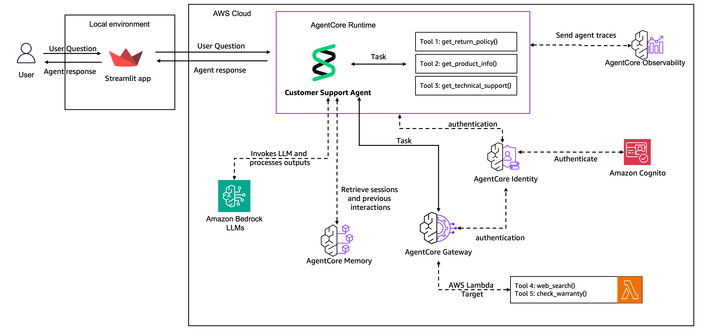

# Amazon Bedrock AgentCore End-to-End Lab

This repository contains a hands-on workshop for building and evolving an AI customer support agent using Amazon Bedrock AgentCore. The project starts with a local prototype and progresses through memory, shared tool access, deployment, and a production-style frontend.

The labs are designed to demonstrate how an agentic application can move from prototype to production using AWS-native services and Bedrock-powered orchestration.

## Overview

The project demonstrates a complete customer support workflow for an electronics retailer, including:

- Product and policy lookup tools
- Troubleshooting and web-based research
- User memory across sessions
- Secure shared tool exposure through AgentCore Gateway
- Agent deployment to a managed runtime
- Monitoring and observability
- A customer-facing Streamlit front end

## Architecture

By the end of the labs, the solution evolves from a local prototype into a layered architecture like this:



## Lab Journey

### Lab 1: Create an Agent Prototype
Build the initial customer support agent and connect local tools for:

- policy lookup
- product information lookup
- troubleshooting/search assistance

### Lab 2: Add Agent Memory
Upgrade the agent with persistent context so it can remember customer preferences and session history.

### Lab 3: Use AgentCore Gateway and Identity
Move tool usage behind shared, secure services and demonstrate enterprise-ready access patterns.

### Lab 4: Deploy to AgentCore Runtime
Deploy the agent to a managed runtime and enable observability and production-style execution patterns.

### Lab 5: Build a Frontend
Create a customer-facing web app with authentication and live chat interactions.

### Lab 6: Cleanup
Remove AWS resources created during the workshop.

## Repository Structure

```text
amazon-bedrock-agentcore/
├── Knowledge_base_data/          # Knowledge base documents for support scenarios
├── images/                       # Architecture and UI screenshots
├── lab_helpers/                  # Helper scripts and utility modules
├── prerequisite/                 # AWS infrastructure and Lambda-related resources
├── scripts/                      # Setup and cleanup scripts
├── lab-01-create-an-agent.ipynb
├── lab-02-agentcore-memory.ipynb
├── lab-03-agentcore-gateway.ipynb
├── lab-04-agentcore-runtime-u.ipynb
├── lab-05-frontend.ipynb
├── lab-06-cleanup-COMPLETE.ipynb
├── Optional-lab-agentcore-observability.ipynb
├── requirements.txt
├── README.md
└── ...
```

## Prerequisites

Before starting, make sure you have:

- An AWS account
- Access to Amazon Bedrock foundation models
- AWS CLI installed and configured
- Python 3.10 or newer
- A supported AWS region with Bedrock model access enabled
- Permissions to create the required AWS resources for the labs

Recommended setup:

- Configure credentials with `aws configure` or an AWS SSO login
- Set your region in the environment, for example:

```bash
export AWS_REGION=us-east-1
```

## Getting Started

1. Clone the repository.
2. Create and activate a Python virtual environment.
3. Install dependencies:

```bash
pip install -r requirements.txt
```

4. Configure AWS access.
5. Start with Lab 1:

- [lab-01-create-an-agent.ipynb](lab-01-create-an-agent.ipynb)

## Recommended Flow

The labs are incremental, and each one builds on the previous one:

1. Prototype the agent locally
2. Add memory for continuity and personalization
3. Centralize shared tools through Gateway and Identity
4. Deploy the service to AgentCore Runtime
5. Expose it through a user-facing app
6. Clean up AWS resources when finished

## Key Technologies

- Amazon Bedrock
- Amazon Bedrock AgentCore
- Strands Agents
- AWS Lambda
- Streamlit
- AWS Identity and Access Management (IAM)
- Amazon CloudWatch / observability

## Useful Notes

- The lab uses a customer support scenario for consumer electronics.
- The knowledge base documents are stored under `Knowledge_base_data/` and support product troubleshooting and warranty workflows.
- Several helper files under `lab_helpers/` support the notebooks and front-end implementation.
- The infrastructure templates in `prerequisite/` assist with required AWS resources.

## Cleanup

When you are finished with the workshop, run the cleanup lab or the cleanup scripts to remove the AWS resources created during the exercises.

## License

This project is for educational and workshop use. Check with your organization or environment before reusing it in production or commercial scenarios.


